<!-- CUSTOM ANIMATED HEADER — ASHUTOSH in glowing gradient with floating orbs -->

 

<!-- TYPING ANIMATION -->

 

<!-- SOCIAL LINKS — minimal, flat style -->
&nbsp;&nbsp;
&nbsp;&nbsp;
&nbsp;&nbsp;

<!-- DIVIDER -->

 

<!-- ABOUT ME — with coding gif -->

### ⚡ About

I'm a **Full-Stack Engineer & AI Systems Architect** who ships production-grade software — from pixel-perfect frontends to distributed backend services to intelligent AI pipelines.

- 🔭 &nbsp;Shipping **[Sprint-OS](https://github.com/Ashurai84)** — academic command center
- 🧠 &nbsp;Building **Dhwani AI** — neural voice synthesis & agents
- 📲 &nbsp;Created **PostAura** — social media automation suite
- 🏥 &nbsp;Built **Smart Hospital Queue** — real-time triage routing
- 🤖 &nbsp;Deep into **RAG pipelines**, **LLMs** & **agentic workflows**
- 📫 &nbsp;**Raia40094@gmail.com**

 

<!-- DIVIDER -->

 

### 🧬 Stack

**Languages**\

**Frontend & Mobile**\

**Backend & Data**\

**AI & Tools**\

<!-- DIVIDER -->

 

### 🚀 Projects

| | Project | What it does | Built with |
|:---:|:---|:---|:---|
| ⚡ | **Sprint-OS** | Academic command center — syllabus tracking, analytics, timers | `React` `Vite` `Tailwind` `Node` |
| 🎙️ | **Dhwani AI** | Neural voice synthesis & conversational AI platform | `Python` `PyTorch` `FastAPI` `LLMs` |
| 📲 | **PostAura** | Social media automation — scheduling & analytics | `Next.js` `PostgreSQL` `Redis` `BullMQ` |
| 🏥 | **Smart Hospital** | Intelligent triage & real-time queue management | `MERN` `WebSockets` |
| 🏡 | **Smart Home** | IoT home automation with voice control & mobile app | `React` `Node` `Flutter` `IoT` |
| 🧠 | **ML Portfolio** | Classification, NLP & computer vision experiments | `Python` `Scikit-Learn` `Pandas` |

<!-- DIVIDER -->

 

### 📊 Stats

&nbsp;&nbsp;

  

  

<!-- DIVIDER -->

 

### 🏆 Trophies

<!-- DIVIDER -->

 

### 📊 Profile Summary

 

 

<!-- CUSTOM ANIMATED FOOTER -->

  

